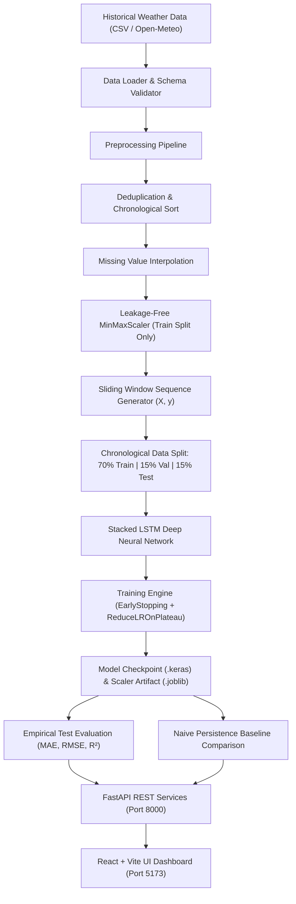

# Weather Forecasting Using LSTM

A production-grade, end-to-end Deep Learning web application for time-series weather forecasting. Built for B.Tech Computer Science / Data Science & AI academic projects.

---

## 1. Project Overview

This project implements a recurrent neural network using **Stacked Long Short-Term Memory (LSTM)** units to model sequential atmospheric temperature dynamics. By analyzing continuous sequences of past hourly weather observations (lookback window), the model predicts future temperatures across configurable forward horizons (+1h, +6h, +12h, +24h, +48h).

The system includes:
- **No data leakage**: Scalers are strictly fitted on chronological training splits.
- **Empirical baseline comparison**: The LSTM model is objectively evaluated against a naive persistence baseline ($T_{t+1} = T_t$).
- **End-to-End full stack**: FastAPI asynchronous REST backend, React + TypeScript Vite frontend, Tailwind CSS, and interactive Recharts visualizations.

---

## 2. Methodology & Architecture

### System Architecture Flowchart



### LSTM Neural Network Architecture

```
=================================================================
 Layer (type)                Output Shape              Param #   
=================================================================
 sequence_input (InputLayer)  [(None, 24, 1)]           0         
 lstm_layer_1 (LSTM)         (None, 24, 64)            16,896    
 dropout_1 (Dropout)         (None, 24, 64)            0         
 lstm_layer_2 (LSTM)         (None, 64)                33,024    
 dropout_2 (Dropout)         (None, 64)                0         
 forecast_output (Dense)     (None, 1)                 65        
=================================================================
 Total params: 49,985 (195.25 KB)
 Trainable params: 49,985 (195.25 KB)
 Non-trainable params: 0 (0.00 Byte)
=================================================================
```

---

## 3. Technology Stack

- **Deep Learning / ML**: TensorFlow 2.x / Keras, Scikit-learn, NumPy, Pandas, Joblib
- **Backend API**: FastAPI, Uvicorn, Pydantic v2, Python-Multipart
- **Frontend SPA**: React 18 / 19, TypeScript, Vite, Tailwind CSS, Lucide React
- **Data Visualization**: Recharts (interactive zooming, tooltips, responsive SVG charts)
- **Automated Testing**: Pytest, FastAPI TestClient, HTTPX

---

## 4. Dataset Source & Documentation

- **Location**: New Delhi Weather Station (28.6139° N, 77.2090° E)
- **Time Horizon**: 2020-01-01 00:00:00 to 2023-12-31 23:00:00 (4 full years)
- **Temporal Resolution**: Hourly (`1H` sampling rate, 35,046 total observations)
- **Features Included**:
  - `timestamp`: ISO-8601 observation timestamp
  - `temperature_celsius`: Ambient air temperature (°C)
  - `humidity_percent`: Relative atmospheric humidity (%)
  - `pressure_hpa`: Sea-level atmospheric barometric pressure (hPa)
  - `wind_speed_kmh`: Surface wind speed (km/h)
- **Limitations**: Synthetic demonstration dataset modeled from historical climatology of the Indo-Gangetic plain with simulated diurnal cycle ($T_{amp} \approx 14^\circ\text{C}$), seasonal monsoon transitions, and sensor dropout gaps.

---

## 5. Quick Start Instructions

### Prerequisites
- Python 3.10+ (Tested on Python 3.12)
- Node.js 18+ and npm

### Step 1: Clone and Setup Python Environment

```powershell
# Windows PowerShell
git clone <repo-url>
cd weather-forecasting-lstm

# Install backend dependencies
python -m pip install -r backend/requirements.txt
```

```bash
# macOS / Linux
git clone <repo-url>
cd weather-forecasting-lstm

# Install backend dependencies
python3 -m pip install -r backend/requirements.txt
```

### Step 2: Install Frontend Dependencies

```powershell
# Windows PowerShell
cd frontend
npm.cmd install
cd ..
```

```bash
# macOS / Linux
cd frontend
npm install
cd ..
```

### Step 3: Run the Automated Test Suite

```powershell
# Windows PowerShell
python -m pytest backend/tests -v
```

```bash
# macOS / Linux
pytest backend/tests -v
```

### Step 4: Launch the Backend Service

```powershell
# Windows PowerShell
python -m uvicorn backend.app.main:app --host 0.0.0.0 --port 8000 --reload
```

Backend will be live at: `http://localhost:8000`  
Swagger API Docs available at: `http://localhost:8000/docs`

### Step 5: Launch the Frontend Web Dashboard

In a separate terminal:

```powershell
# Windows PowerShell
cd frontend
npm.cmd run dev
```

```bash
# macOS / Linux
cd frontend
npm run dev
```

Open your browser at: `http://localhost:5173`

---

## 6. One-Click Convenience Startup Scripts

### Windows PowerShell (`start_project.ps1`)
Run:
```powershell
.\scripts\start_project.ps1
```

### macOS / Linux (`start_project.sh`)
Run:
```bash
chmod +x scripts/start_project.sh
./scripts/start_project.sh
```

---

## 7. Model Training & Evaluation

You can train the model either via the web UI at `http://localhost:5173/training` or using the CLI script:

```powershell
python scripts/train_baseline_and_lstm.py
```

### Empirical Evaluation Protocol
The model is compared against a **Naive Persistence Baseline** on an unseen chronological test split (15% of records):

$$\text{Baseline: } \hat{T}_{t+1} = T_t$$

Metrics reported:
1. **MAE (Mean Absolute Error)**: $\frac{1}{N} \sum_{i=1}^N |y_i - \hat{y}_i|$ in degrees Celsius.
2. **RMSE (Root Mean Squared Error)**: $\sqrt{\frac{1}{N} \sum_{i=1}^N (y_i - \hat{y}_i)^2}$ in degrees Celsius.
3. **$R^2$ Score**: $1 - \frac{\sum (y_i - \hat{y}_i)^2}{\sum (y_i - \bar{y})^2}$.

---

## 8. REST API Reference

| Method | Endpoint | Description |
|--------|----------|-------------|
| `GET` | `/api/health` | Service health status and model load state |
| `GET` | `/api/dataset/info` | Dataset records, date ranges, and temperature statistics |
| `GET` | `/api/history` | Historical observations with date range filtering |
| `POST` | `/api/data/upload` | Upload custom weather CSV file |
| `POST` | `/api/data/columns` | Configure timestamp and temperature target columns |
| `POST` | `/api/model/train` | Trigger background LSTM model training |
| `GET` | `/api/model/status` | Poll live training progress and status |
| `GET` | `/api/model/metrics` | Retrieve test evaluation metrics and baseline comparison |
| `POST` | `/api/predict` | Generate single- or multi-step temperature forecasts |
| `GET` | `/api/forecast` | Retrieve forward forecasted trajectory (+24h default) |

---

## 9. Academic Project Outline (B.Tech CS / AI)

1. **Title**: Recurrent Neural Networks for Short-Term Atmospheric Temperature Forecasting
2. **Problem Statement**: Standard statistical methods (e.g. ARIMA) struggle with non-linear diurnal cycles and multi-day meteorological memory. Stacked LSTMs capture temporal dependencies via gated cell states.
3. **Data Preprocessing**: Handling chronological ordering, missing observations through interpolation, and preventing data leakage by fitting scalers exclusively on training splits.
4. **Experimental Setup**: 70% Train, 15% Validation, 15% Test. Input sequence length $L=24$ hours.
5. **Ablation & Comparison**: Evaluating against Naive Persistence to prove empirical deep learning gain.
6. **Deployment**: Decoupled microservice architecture with asynchronous background training and responsive dashboard.

---

## 10. License & Ethics

Distributed for academic research and educational evaluation. Weather forecasts synthesized by this application are experimental machine learning models and must not be used for emergency or life-critical meteorological alerts.
